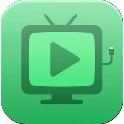
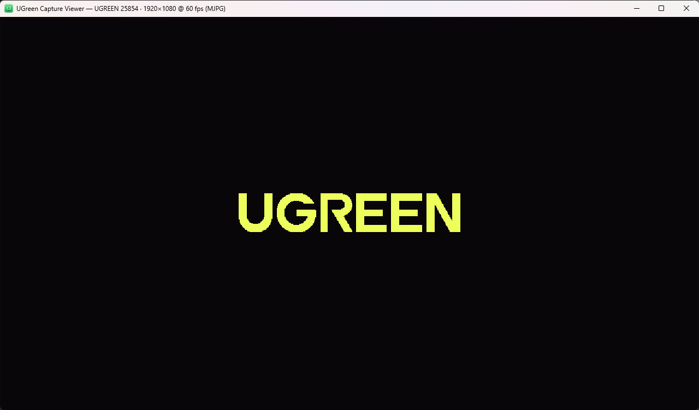
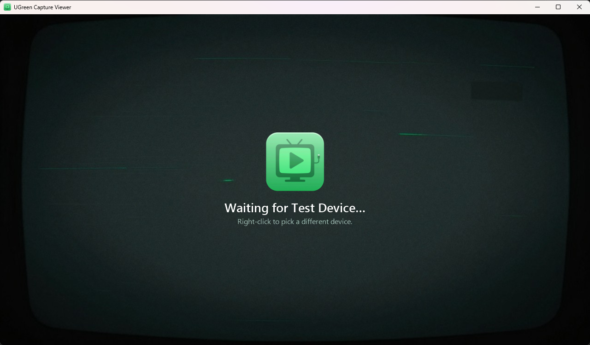

<p align="center"></p>

# UGreen Capture Card Viewer

A tiny, no-fuss Windows app for watching a **UGREEN USB capture card** (or any other webcam/capture device) in a normal window. Move it, resize it, maximize it, go fullscreen. It's for playing a console or watching a camera on your PC without opening OBS.

| Live feed | Waiting for the device |
| --- | --- |
|  |  |

## Features

- **Finds the card automatically.** It picks the first video device with "UGREEN" in its name (tested with the UGREEN 25854).
- **Low latency.** Video is drawn the moment each frame arrives, with no clock scheduling. Audio uses small buffers.
- **Picks the best format by itself.** It chooses up to 1080p at the highest frame rate the card offers, and you can change this from the menu.
- **Plays the card's audio** by matching its audio input (e.g. *Digital Audio Interface (UGREEN 25854)*).
- **Reconnects automatically.** If the card is unplugged, or another app like OBS or Discord is holding it, the viewer waits and picks it back up.
- **Keeps the picture's shape.** It adds black bars instead of stretching the picture.
- **Remembers** the window position, device, format, mute and always-on-top state.

## Controls

| Action | How |
| --- | --- |
| Fullscreen on/off | Double-click, **F11**, or **Alt+Enter** |
| Leave fullscreen | **Esc** |
| Mute | **M** |
| Always on top | **T** |
| Restart capture | **R** |
| Menu: video device, audio device, resolution/FPS | **Right-click** |

## Download & run

1. Install the [.NET 9 Desktop Runtime](https://dotnet.microsoft.com/download/dotnet/9.0) (x64) if you don't already have it.
2. Download `UGreenCapViewer.exe` from the [Releases](../../releases) page, or build it yourself (below).
3. Run it. If Windows SmartScreen warns about an unknown publisher, choose *More info → Run anyway*.

## Build from source

Requirements: Windows 10/11 and the [.NET 9 SDK](https://dotnet.microsoft.com/download/dotnet/9.0).

```powershell
git clone https://github.com/Njordics/UGreen-Capture-Card-Viewer.git
cd UGreen-Capture-Card-Viewer

# run it
dotnet run -c Release

# or build a single-file exe into .\publish
dotnet publish -c Release -r win-x64 --self-contained false -p:PublishSingleFile=true -o publish
```

Add `--self-contained true` if you want an exe that runs without .NET installed. It will be much larger.

## How it works

| File | What it does |
| --- | --- |
| [`CaptureSession.cs`](CaptureSession.cs) | Sets up the DirectShow capture: video source → windowless VMR9 renderer, plus a separate audio graph. Also lists and applies formats. |
| [`VideoSurface.cs`](VideoSurface.cs) | The area the video is drawn in. Shows the "waiting / no signal" screen when there's no feed. |
| [`MainForm.cs`](MainForm.cs) | The window, right-click menu, hotkeys, fullscreen, and reconnecting on device changes. |
| [`Settings.cs`](Settings.cs) | Saves your settings to `%AppData%\UGreenCapViewer\settings.json`. |

## Artwork (ComfyUI)

The icon and the waiting screen were generated with [ComfyUI](https://github.com/comfyanonymous/ComfyUI) through its web API. You can make your own:

```powershell
# needs ComfyUI running on http://127.0.0.1:8188 (override with COMFY_HOST)
# and the Z-Image Turbo model files (z_image_turbo_bf16, qwen_3_4b, ae)
python tools/gen_art.py my_icon 1024 1024 42 "app icon, a glossy rounded-square badge with a retro TV ..."

# crop the badge and build a multi-size .ico (needs Pillow)
python tools/make_icon.py art/my_icon.png art/app.ico
```

`make_icon.py` cuts out the badge from fixed pixel positions that suit the included render. If your image is laid out differently, change the `box` in the script. Rebuild the app afterwards; the art is built into the exe.

## Using a different capture card

Right-click → **Video device** and pick any camera or capture card. The app remembers your choice. To use a different card by default, change the `"UGREEN"` match in `MainForm.StartCapture`.

## License

MIT, see [LICENSE](LICENSE). You're free to use, modify and redistribute it.
This app uses [DirectShowLib.Standard](https://github.com/luthfiampas/DirectShowLib) (LGPL-2.1); see [THIRD-PARTY-NOTICES.md](THIRD-PARTY-NOTICES.md).
This is an unofficial project and isn't affiliated with UGREEN.
